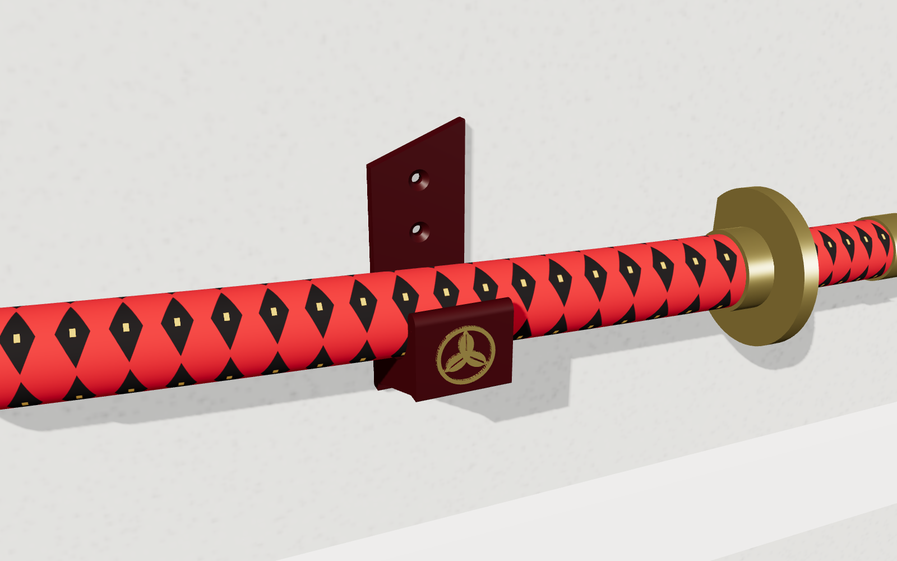
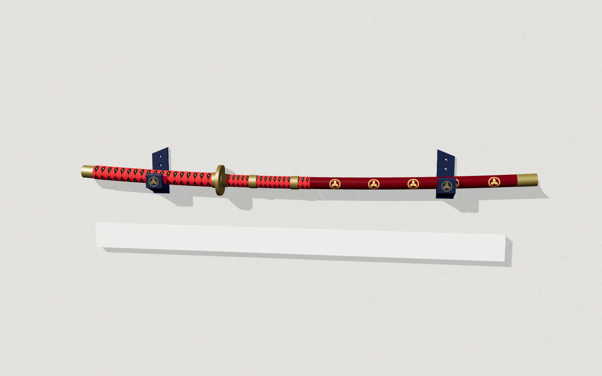
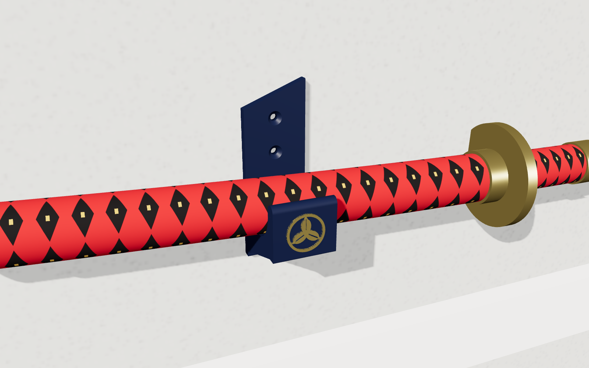
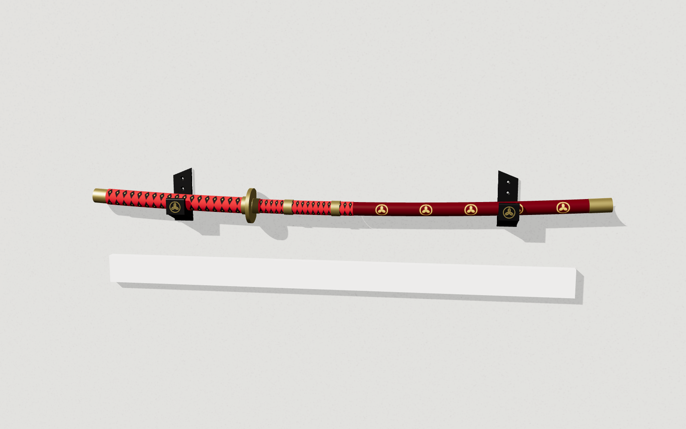
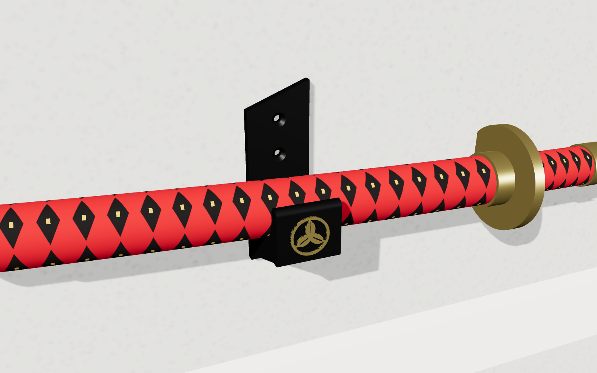

# Soporte de pared para katana

Diseñado a juego con la katana roja y dorada: un mon de tres hojas en relieve
(pintado de dorado) inspirado en los de la saya y el remate cortado en diagonal,
como la punta de la hoja. Son 2 piezas en espejo (izquierda y derecha) para que
las puntas apunten hacia afuera.

**Color recomendado: rojo vino (granate) mate**, el mismo tono de la saya, con el mon dorado.
También se ven las opciones en azul marino (como el edredón) y negro (como los muebles).

| | Montado | Detalle |
|---|---|---|
| Granate |  |  |
| Azul marino |  |  |
| Negro |  |  |

## Equilibrio con la curvatura

La katana tiene una curva suave (sori). Sobre dos cunas se acomoda sola con la
panza de la curva hacia abajo, que es su posición estable: el centro de gravedad
queda lo más bajo posible y entre los dos apoyos (a unos 50 cm de la punta del
mango, y los apoyos están a 19 cm y a ~88 cm). El labio de la cuna sube 24 mm,
más de dos tercios del grueso del mango, así que no se sale aunque roces la pared.

## Medidas de la katana (tomadas de la foto con la regla, aprox.)

- Largo total: ~105 cm
- Tsuka (mango): ~33 cm de largo, ~34 mm de grueso
- Saya (funda): ~72 cm de largo, ~28 mm de grueso

## Archivos

| Archivo | Para qué |
|---|---|
| `soporte_katana_par.stl` | Las dos piezas juntas, listas para imprimir |
| `soporte_katana_izq.stl` / `soporte_katana_der.stl` | Cada pieza por separado |
| `vista_*.stl` | Las piezas en posición de pared (solo para verlas) |
| `generar_soporte.py` | Genera los STL; las medidas están al inicio |
| `render/` | Escena con la que se hicieron las fotos |

## Medidas del soporte (mm)

- Cada pieza: 40 de ancho × 115 de alto × 55 de salida desde la pared.
- Cuna: 40 de hueco con fondo redondo (cabe el mango de 34 mm con fieltro, y la saya también).
- 2 agujeros de Ø4.5 avellanados a Ø9 para tornillo #8 / 4 mm de cabeza plana.

## Impresión

- **Material:** PLA o PETG mate en rojo vino / burgundy (o el color que elijas).
- **Orientación:** como viene el STL, acostado de lado. Sin soportes.
- **Capa:** 0.2 mm · **Paredes:** 4 · **Relleno:** 30 % gyroid.
- **Mon dorado:** píntalo con un marcador de pintura dorada (punta fina) después de imprimir.
- Unos 45–55 g por pieza.

## Instalación

1. Pega fieltro adhesivo (negro o vino) dentro de cada cuna.
2. La pieza **izquierda** va bajo el mango, a unos 19 cm de la punta del mango (kashira).
   La **derecha** va bajo la saya, a unos 17 cm del extremo dorado (kojiri). Quedan ~69 cm entre ellas.
3. La derecha va 3 mm más arriba que la izquierda: la saya es más delgada que el mango y así la katana queda nivelada.
4. Sobre la puerta: la base de las piezas a unos 212 cm del piso. Tornillo a montante o taquete para tablaroca.
